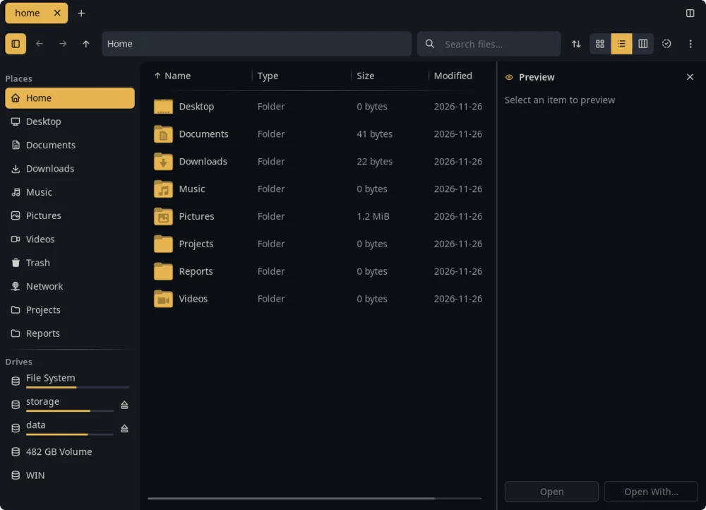

Start Luciole, learn the window layout and pick up the shortcuts you will use most.



## Start Luciole

```sh
luciole
luciole /path/to/folder
luciole 'file:///path/to/folder'
```

Without an argument, Luciole opens Home. Pass one directory path or URI to start elsewhere. A relative path names a folder under the directory where you ran the command. Remote addresses need the matching system backend; see [Network folders](/luciole/network/).

All windows share one Luciole process. Starting `luciole` while it runs opens a new window in that process, which costs far less memory than a separate instance. The process exits when its last window closes.

| Command | Effect |
|---|---|
| `luciole --help` | Show command syntax |
| `luciole --version` | Show the version and build revision |
| `luciole completions <shell>` | Print `bash`, `zsh` or `fish` completions |
| `luciole config validate <file>` | Check one TOML settings file without opening a window |

Bash, Zsh and Fish completions are installed with Luciole.

:::note
Installing Luciole does not make it the default file manager.
:::

## Tour the window

From top to bottom:

- **Toolbar**: sidebar button (`F9`), back, forward and parent-folder arrows, view and sort controls, File Operations and the main menu.
- **Location bar**: breadcrumbs for the current folder. Click it or press `Ctrl+L` to type an address.
- **Sidebar**: Places, pinned folders and Drives.
- **File area**: the folder contents in grid, list or column view.
- **Preview**: details of the selected file; toggle it with `F8`.
- **Status bar**: action messages, search and selection results. **Settings → Appearance → Always Show Status Bar** keeps it visible when idle.

## Learn the essential shortcuts

| Shortcut | Action |
|---|---|
| `Ctrl+L` | Edit the location |
| `Ctrl+F` | Search |
| `Alt+Left` | Back |
| `Alt+Up` | Go to the parent folder |
| `Ctrl+T` | New tab |
| `F3` | Split view |
| `Ctrl+1`, `Ctrl+2`, `Ctrl+3` | Grid, list, column view |
| `F8` | Toggle the preview |
| `Ctrl+,` | Open Settings |
| `F1` | Show all keyboard shortcuts |

The full list is in [Keyboard shortcuts](/luciole/keybinds/).

## Find your settings

Press `Ctrl+,` to open Settings inside the current window. Preferences save automatically. About is in the main menu. See [Settings](/luciole/settings/) and the [configuration reference](/luciole/configuration/).
