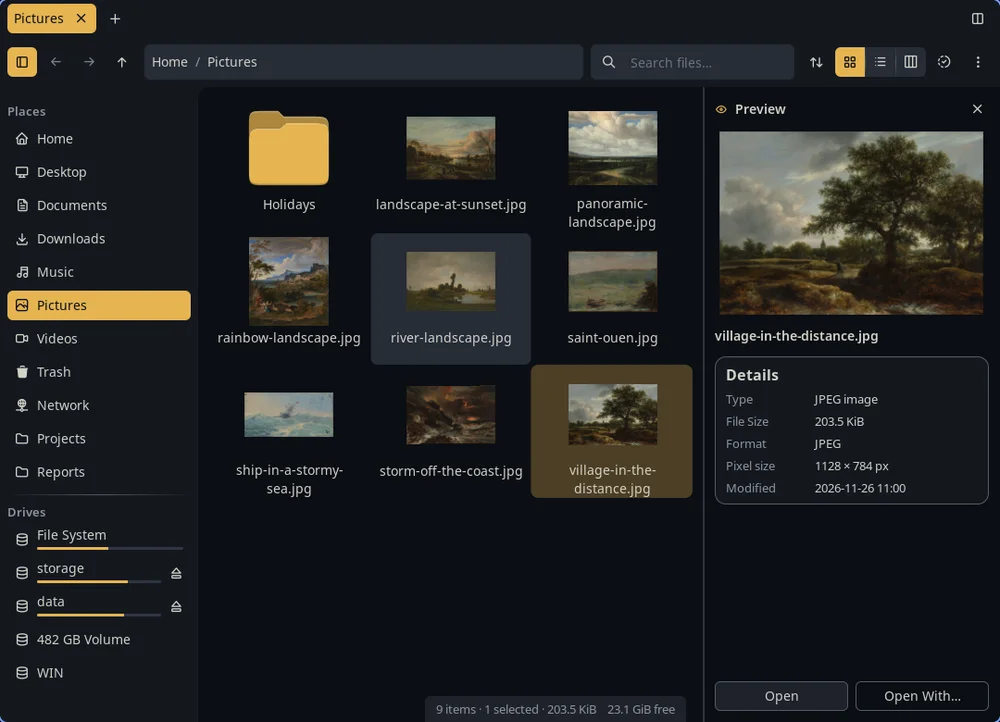

Luciole is a native Wayland file manager with grid, list and column views, tabs, split view and a side preview. It runs independently of the Noctalia shell. The application is in development; these guides describe current features.

## Guides

| Page | Purpose |
|---|---|
| **Getting started** | |
| [Installation](/luciole/installation/) | Install from a package, Nix or Guix |
| [Building from source](/luciole/building/) | Dependencies and build commands |
| [Getting started](/luciole/getting-started/) | Start Luciole, tour the window, learn shortcuts |
| [File picker](/luciole/file-picker/) | Use Luciole for other applications' Open and Save dialogs |
| **Basics** | |
| [Navigation](/luciole/navigation/) | Location bar, search, history and keyboard navigation |
| [Views](/luciole/views/) | Grid, list and column views, sorting and selection |
| [Tabs and split view](/luciole/tabs-and-windows/) | Tabs, two panes and windows |
| [Sidebar and drives](/luciole/sidebar/) | Places, pinned folders, drives and unlocking |
| [Preview and Properties](/luciole/preview-and-properties/) | Preview files, inspect details and permissions |
| **Files** | |
| [File operations](/luciole/file-operations/) | Copy, move, rename, drag and drop, conflicts |
| [Undo and redo](/luciole/undo-redo/) | Reverse the last file operation |
| [Trash](/luciole/trash/) | Delete, restore and empty the Trash |
| [File operations](/luciole/file-operations/) | Copy, move, create, rename and background operations |
| [Undo and redo](/luciole/undo-redo/) | What you can take back |
| [Trash](/luciole/trash/) | Delete, restore and empty |
| [Archives](/luciole/archives/) | Browse, extract and create archives |
| [Opening files](/luciole/opening-files/) | Default apps, Open With, running programs, terminals |
| [Custom scripts](/luciole/scripts/) | Add your own actions |
| **Network** | |
| [Network folders](/luciole/network/) | SFTP, SMB and WebDAV locations |
| **Customize** | |
| [Settings](/luciole/settings/) | Tour the Settings page |
| [Configuration reference](/luciole/configuration/) | Every `config.toml` key |
| [Keyboard shortcuts](/luciole/keybinds/) | Default shortcuts and customization |
| **Help** | |
| [Troubleshooting](/luciole/troubleshooting/) | Symptoms, causes and fixes |

## Get help

Report problems on the [issue tracker](https://github.com/noctalia-dev/luciole/issues) or ask on [Discord](https://discord.noctalia.dev). Include the Luciole version, your distribution and a small reproduction. For development, see [Contributing](https://github.com/noctalia-dev/luciole/blob/main/CONTRIBUTING.md), the [design notes](https://github.com/noctalia-dev/luciole/blob/main/docs/design/README.md) and [Packaging](https://github.com/noctalia-dev/luciole/blob/main/PACKAGING.md).
