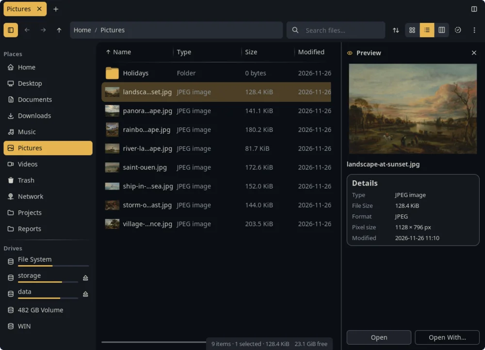

See what a file contains and inspect its details without opening it.

## Use the side preview

The side preview is on by default. `F8` toggles it, and **Settings → Appearance → Show Preview** controls it too. Drag its divider to change the saved width. Small windows collapse it temporarily when there is no room.

It shows essential facts such as size, dimensions, format and duration when available. Selecting a folder shows its calculated size and how many files and folders it holds. Large folders may take a moment or report a partial result.

## Open a quick preview

Select one item and press `Space`. Press `Space` or `Escape` to close it.

In the quick preview, `Left` and `Right` step one item. `Up` and `Down` step one list item or one grid row.

Images, video stills, the first PDF page and embedded audio artwork depend on installed thumbnailers. Video previews are still images, not playback. See [optional features](/luciole/installation/#optional-features).

## Preview text and desktop entries

Readable local UTF-8 text formats, including YAML and desktop-entry contents, have text previews. Desktop entries also show their localized application or link name and description in the preview and in Properties.

## Check file types

Luciole uses the system MIME database, and inspects content when the name is not enough. A text `.bash_history` can show as **Plain text document** with MIME `text/plain`; an unrecognized binary stays a generic file. The list, preview and Properties show the same type.

## Open Properties

Press `Alt+Return`, or hold `Alt` while clicking an item (single-click with single-click opening, double-click with double-click opening). `Alt`-click works in List, Grid and Columns; `Alt`-drag still offers the transfer action menu.

Properties shows the facts the system can read. Images can include pixel dimensions, videos codecs and duration, and PDFs page information. A mounted drive's Properties shows its file system type and live free space. The dialog stays open when you switch windows; close it with its buttons or `Escape`.

## Count a folder's contents

For a folder, Properties starts a separate recursive count and size calculation. Its **Stop** button cancels it, and detailed notes appear when parts could not be read.

Totals stay inside the starting filesystem: a folder mounted inside the tree counts as one folder and is not entered unless you selected it too. Totals are unavailable for network locations and Trash.

## Inspect a symbolic link

For a symbolic link, Properties and the side preview show **Link Target** as stored in the link and **Resolved Target** as the final absolute path. A missing, inaccessible or looping target shows **Target Status** instead.

The other facts and permission controls describe the link itself, and a folder link's target contents are not counted. Opening a valid link follows its target. An unavailable target reports an error and keeps the current folder open.

## Change permissions and ownership

Properties edits permissions and ownership on local files. With several items selected, changes apply to all of them. Recursive changes are explicit: selecting a folder never changes its contents by itself.

**Advanced Permissions** opens the POSIX ACL editor on supported local filesystems. Luciole reports changes the system refuses or does not support instead of claiming success.

:::note
Recursive permission changes skip mounted network shares inside the folder.
:::

## Change a folder's icon

Local folders have a **Change Icon…** button in the Properties header. See [custom folder icons](/luciole/views/#show-custom-folder-icons).
