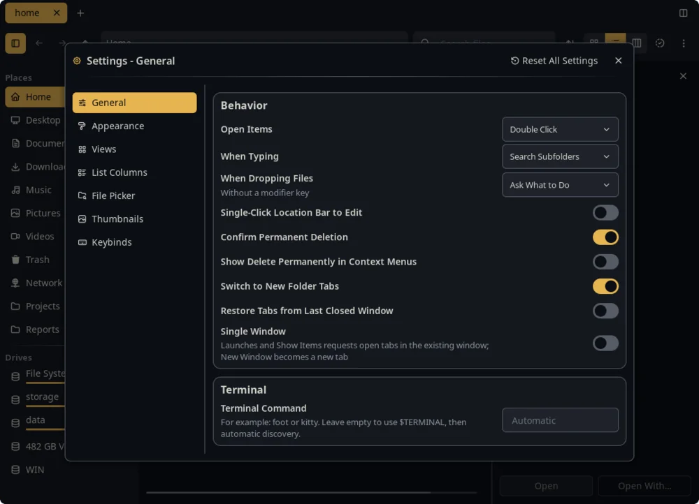

Settings is the in-app page for every preference; use it for day-to-day changes and edit files only for declarative setups.



## Open Settings

Press `Ctrl+,` or choose Settings in the main menu. It opens as a page inside the current window and stays open when another window gains focus, with your category and unfinished edits intact. Close it with `Escape` or its close button.

In a narrow window, the category list collapses into compact navigation. Enlarging the window restores the normal layout.

## Change a setting

Changes save automatically and apply right away; there is no Apply button. Categories:

| Category | Covers |
| --- | --- |
| **General** | Opening items, typing, dropping files, tabs, single window, terminal |
| **Appearance** | Color scheme, opacity, corners, menus, animations, toolbar, sidebar, preview |
| **Views** | View mode, density, zoom, sorting, captions, long filenames |
| **List Columns** | Expandable folders, visible columns, order and widths |
| **File Picker** | Start folder, view, preview and sorting for file picker windows |
| **Thumbnails** | Thumbnail policy, size limit, cache inspection and clearing |
| **Keybinds** | Shortcuts; see [Keyboard shortcuts](/luciole/keybinds/) |

Every control maps to a key in [`config.toml`](/luciole/configuration/#browser-preferences).

## Arrange the toolbar

Right-click a toolbar button to move it left or right, show or hide the sidebar, parent folder, sort and view buttons, or reset the order. **Appearance → Toolbar** has the same switches, and sets when the File Operations button shows: always, only while a job runs or has failed, or never. Hidden actions stay in the main menu.

## Reset settings

Setting a control back to the value from `config.toml` or the built-in default removes its saved override. To discard all of them, click **Reset All Settings**, then **Confirm Reset**. Your `config.toml` is never changed.

## Find the files

| Data | Location |
| --- | --- |
| Base configuration (yours, optional) | `$XDG_CONFIG_HOME/luciole/config.toml` |
| Overrides written by Settings | `$XDG_CONFIG_HOME/luciole/settings.toml` |
| Palette from Noctalia (optional) | `$XDG_CONFIG_HOME/luciole/colors.toml` |
| Pinned folders | `$XDG_CONFIG_HOME/gtk-3.0/bookmarks` |
| Sidebar layout, last window | `$XDG_STATE_HOME/luciole/state.toml` |
| Per-folder view and sort | `$XDG_STATE_HOME/luciole/folder_views.toml` |
| Thumbnails | `$XDG_CACHE_HOME/thumbnails/` |
| Custom actions | `$XDG_DATA_HOME/luciole/scripts/` |

Unset variables fall back to `~/.config`, `~/.local/state`, `~/.cache` and `~/.local/share`. See [Configuration reference](/luciole/configuration/#files-and-precedence) for precedence, and [Custom scripts](/luciole/scripts/) for the scripts directory.

## Validate a file

Check a configuration file without opening a window:

```sh
luciole config validate /path/to/config.toml
```

The command reads only that file, ignores `settings.toml` and reports unknown keys as well as invalid values.
