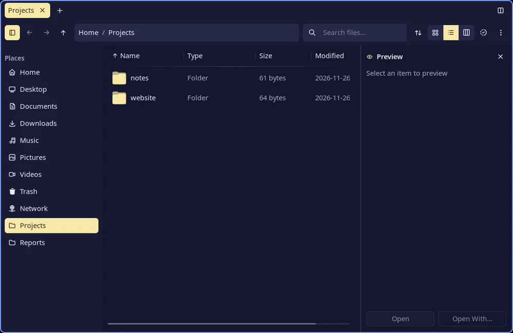

The sidebar lists your places, pinned folders and drives, and can show a folder tree.

## Show or hide the sidebar

Press `F9` or use the toolbar's sidebar button. **Settings → Appearance → Sidebar** controls visibility, width, drive rows and the optional **Show Folder Tree**. **Settings → List Columns → Expandable Folders** adds a tree within List view. Both tree options are off by default.

Below 760 logical pixels wide, the sidebar hides, and `F9` opens it as a drawer over the file area.

- Selecting a destination, `Escape`, `F9` or a click outside closes the drawer.
- `Tab` and `Shift+Tab` stay inside the open drawer.
- Widening the window restores your saved sidebar setting.

## Use Places

Places holds Home, available user folders, Trash, Network and your pinned folders. Middle-click a Places or drive row to open it in a new tab.

Trash can be reordered but not unpinned, and its context menu offers **Empty Trash**. Drop files or folders on the Trash row to move them there; only moves are accepted. See [Trash](/luciole/trash/).

## Pin a folder

Pin or unpin a folder from its context menu, or drag a folder into Places. Drag rows to reorder them.

Pins are stored in the GTK bookmarks file, `$XDG_CONFIG_HOME/gtk-3.0/bookmarks` (by default `~/.config/gtk-3.0/bookmarks`). Luciole reads it live and writes your changes back, so GTK applications and file dialogs show the same pins. A change made elsewhere appears automatically.

The built-in Places layout, separators, headings and custom pin icons are kept in Luciole's own state, so other applications do not see them.

## Group places with separators and headings

1. Right-click a place and choose **Add Separator Below**. Repeat as often as you like.
2. Drag a separator to another gap, or right-click it for **Move Up**, **Move Down** and **Remove Separator**.
3. Right-click a separator and choose **Add Heading…** to label the group. **Rename Heading…** and **Remove Heading** change it later.

A place's **Move Up** and **Move Down** carry it across a separator. The folder tree does not show separators.

## Change a pin's icon

Choose **Change Icon…** in a bookmark's context menu and pick a [Tabler icon](https://tabler.io/icons). The icon is not shared with other applications. Choose **Reset to Default** to restore the standard icon.

## Show or hide Network

The **Network** entry is shown by default. Drag it, or use **Move Up** and **Move Down**, to move it. **Settings → Appearance → Sidebar → Show Network** or its **Hide Network** menu item hides it in both sidebar modes. See [network folders](/luciole/network/).

## Use Drives

Drives starts with File System (`/`), then removable media, extra partitions and network mounts. System mounts such as `/home` and bind mounts are not listed.

A mounted drive shows a bar of used space under its row, red at 90% used or more. Unmounted drives and filesystems that report no size have no bar. Hovering a mounted drive shows its mountpoint and free space.

Right-click a mounted drive for **Open**, its removal action when available, and **Properties**.

Phones, players and cameras over MTP or PTP take their icon from udev's `ID_MEDIA_PLAYER_ICON_NAME`. A udev rule can set it to any [Tabler icon](https://tabler.io/icons) name, such as `device-watch`.

## Unlock an encrypted drive

1. Click the LUKS drive's row under Drives.
2. In **Unlock Drive**, enter the passphrase and choose **Unlock**.
3. The mounted folder opens once unlocking succeeds. If it fails, click the drive again to retry.

`Escape`, **Cancel**, navigating elsewhere or closing the pane stops the request. Your current folder stays visible until mounting succeeds. Luciole never writes passphrases to its configuration or history.

Unlocking needs the UDisks2 system service and working D-Bus connections. System policy may ask for authorization. Key management and locking remain with system disk tools.

## Eject or remove a drive

The eject button and the drive's context menu offer the right action: **Safely Remove** powers off a USB disk plugged in during the session, **Eject** ejects removable media, and **Unmount** handles anything else.

Removal never forces: active operations or programs with open files prevent it, and the status bar names the blockers. [Undo](/luciole/undo-redo/) history involving that drive is discarded.
