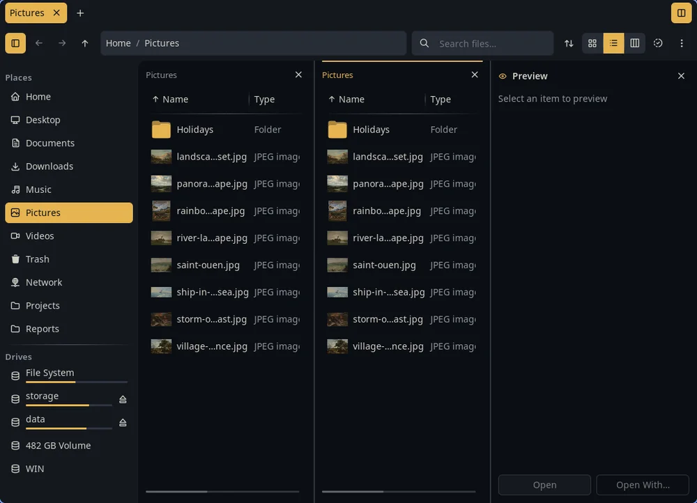

Work in several folders at once with tabs, a split view or separate windows.

## Open and manage tabs

Each tab holds one or two browsing panes. Navigation, search, selection and scroll belong to each pane, and actions target the focused pane.

| Action | Shortcut |
| --- | --- |
| New tab / New window | `Ctrl+T` / `Ctrl+N` |
| Duplicate tab / Reopen closed tab | `Ctrl+Shift+D` / `Ctrl+Shift+T` |
| Close tab / Close focused split pane | `Ctrl+W` / `Ctrl+Alt+W` |
| Next / Previous tab | `Ctrl+Tab` / `Ctrl+Shift+Tab` |
| Toggle split / Switch pane | `F3` / `F6` |

The tab bar is shown even with one tab. **Settings → Appearance → Always Show Tab Bar** can hide it. When tabs do not fit, scroll the bar with the mouse wheel or rest the pointer near either end.

`Ctrl+T`, the plus button, **New Tab** menu actions, duplicating and reopening always switch to the new tab.

## Open a folder in a new tab

Middle-click a folder, breadcrumb or Places row, or use a folder's **Open In → New Tab** menu. By default the new tab becomes active.

1. Turn off **Settings → General → Switch to New Folder Tabs**.
2. Open folders as above. They load in background tabs and your current tab, pane, search, selection and scroll stay put.
3. Click a tab or press `Ctrl+Tab` to visit it.

`Shift`+middle-click reverses the preference for that one opening.

## Split a tab

Press `F3` to show a second pane in the current tab, and `F3` again to close it. `F6` moves focus between panes. `Ctrl+Alt+Enter` on a folder opens it in the other pane, creating the split if needed.

## Reorder tabs and move them to a window

1. Drag a tab along the tab bar. A marker shows where it will land.
2. Hold it near either end of the bar to scroll the bar.
3. Release it below the toolbar to move it into a new window.

With **Single Window** on, or with only one tab, the drop stays in the tab bar. `Escape` cancels the drag.

The empty part of the tab bar acts as the window's title bar: drag to move the window, double-click to maximize or restore it, right-click for the compositor's window menu. Some compositors offer no menu.

## Keep everything in one window

Enable **Settings → General → Single Window**. Launching Luciole with a path, or another application asking to show items, then opens tabs in the existing window. Launching without a path raises that window, and **New Window** opens a tab. File picker windows are unaffected.

## Restore tabs

Enable **Settings → General → Restore Tabs from Last Closed Window** to reopen the last closed window's tabs once, in a new window or on startup without a requested location. The saved session is used up when restored.

See [keyboard shortcuts](/luciole/keybinds/#tabs-and-windows) to change any shortcut.
