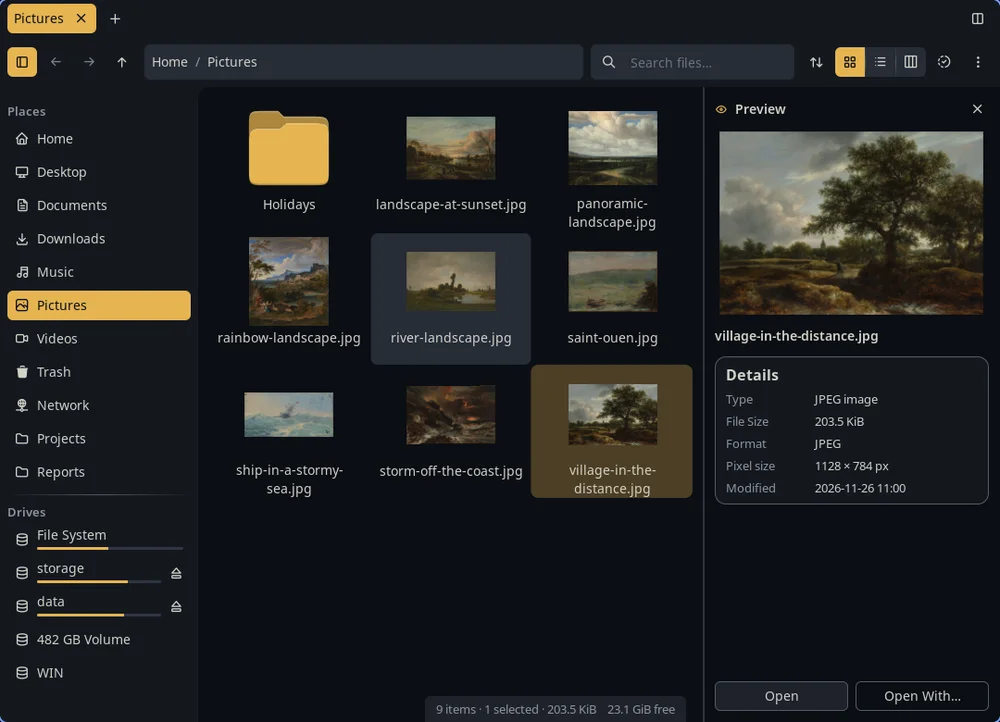
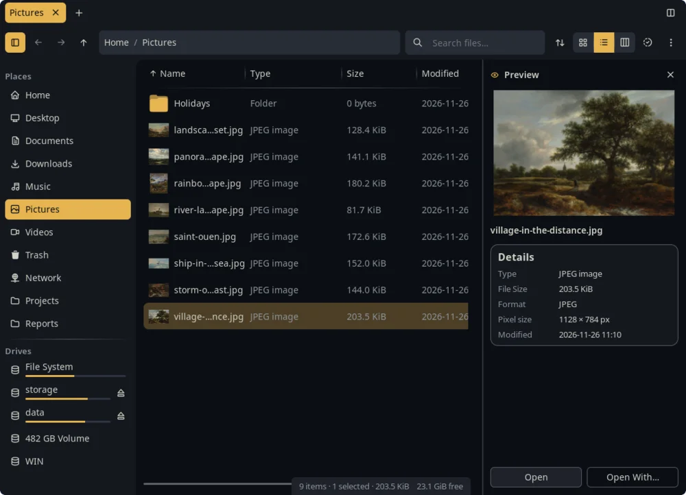
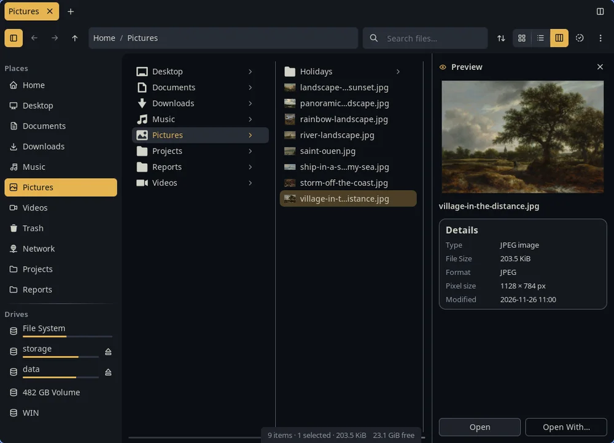

Choose how a folder is shown, sorted and selected.

## Choose a view

Use the toolbar or main menu to pick a view.

| View | Shortcut | Shows |
| --- | --- | --- |
| Grid | `Ctrl+1` | Icons or thumbnails in tiles |
| List | `Ctrl+2` | One row per item with detail columns |
| Columns | `Ctrl+3` | Successive folder levels side by side |

Your choices become defaults for new pages; existing tabs and panes keep their own state. **Settings → Appearance → Reduce Animations** turns off fade-ins and other transitions.

## Zoom

`Ctrl`+wheel, `Ctrl+Plus` and `Ctrl+Minus` change the icon size in every view. `Ctrl+0` resets it. Each view keeps its own size.

## Browse in columns

Selecting a folder reveals its child column; selecting another folder replaces that branch. Drag the dividers to resize columns.

`Right` or `Enter` moves into the selected folder with its first item selected. `Left`, `Backspace` or `Alt+Up` moves back to the parent column. **Settings → Views → Show Parent Folders** is on by default; turn it off to start at the current folder alone.

## Sort items

List headers sort by their column. Grid uses the toolbar's **Sort** menu, and the background right-click menu also offers **Sort**. Changing the order shows its start, and selected items stay selected.

Shown hidden items sort among visible ones by default. **Hidden Last**, in the **Sort** menu and Settings, puts them after the visible ones; **Folders First** then applies within each group.

## Choose list columns

**Settings → List Columns** controls which columns show and their order. Extra columns include accessed and created time, owner, group, permissions and location. Missing metadata shows as unavailable.

Folders show their recursive size in the **Size** column, computed in the background for visible rows. The cell stays blank until the calculation finishes, and `≥` marks a partial result. Network folders stay blank.

:::note
In large folders, names can appear before details. **Reading…** means a value is still loading; **Unknown** means it could not be read.
:::

## Select items

Click an entry to select it, `Ctrl`+click to toggle it and `Shift`+click to select a range. Drag an area to select several.

| Action | Shortcut |
| --- | --- |
| Select all | `Ctrl+A` |
| Invert selection | `Ctrl+Shift+I` |
| Select by pattern | `Ctrl+S` |
| Clear selection | `Escape` |

Only an unselected entry's icon and name count as the entry; a drag can start from the rest of its row or tile. A selected entry can be dragged from anywhere in its highlight.

Opening uses double-click by default. **Settings → General** offers single-click opening. Supported local archives open in the archive browser; see [archives](/luciole/archives/). **Open With** and default applications are in [opening files](/luciole/opening-files/).

## Remember a view per folder

Turn on **Settings → Views → Remember View and Sort per Folder** so the sort menu, list headers and the Grid/List choice change only the current folder. The folder keeps them in every tab and window and across restarts, so Downloads can sort by **Created** while everything else sorts by name.

Folders you never changed follow the defaults. Choose **Use Default View for This Folder**, at the end of the **Sort** menu, to remove its own settings.

A renamed or moved folder starts from the defaults. While Columns is on, folders' own view choices do not apply. File picker windows ignore per-folder settings.

## Shorten long filenames

Overflowing names are shortened in the middle by default, keeping the beginning and ending visible. **Settings → Views → Long Filenames** also offers **Shorten at the End**, applied to open panes at once. Grid wraps names over two lines first.

## Show custom folder icons

Luciole shows the icon set by a folder's `metadata::custom-icon-name` or `metadata::custom-icon` attribute (an image's `file://` URI), or by the `Icon=` key in its `.directory` file (a themed icon name or an absolute image path). Changes appear after the next listing, for example `F5`. Network filesystems keep plain icons.

Links show their target's icon with a link emblem.

To choose an icon yourself, click **Change Icon…** in a local folder's Properties header. The choice is stored in the folder's `metadata::custom-icon-name` and its `.directory` file. Choose **Reset to Default** to restore the standard icon.

## Read the status bar

The status bar at the bottom of the file pane reports actions, search and selection. **Settings → Appearance → Always Show Status Bar** keeps it visible when idle, with the item count and free space when available.

For undo and redo of file changes, see [undo and redo](/luciole/undo-redo/).
